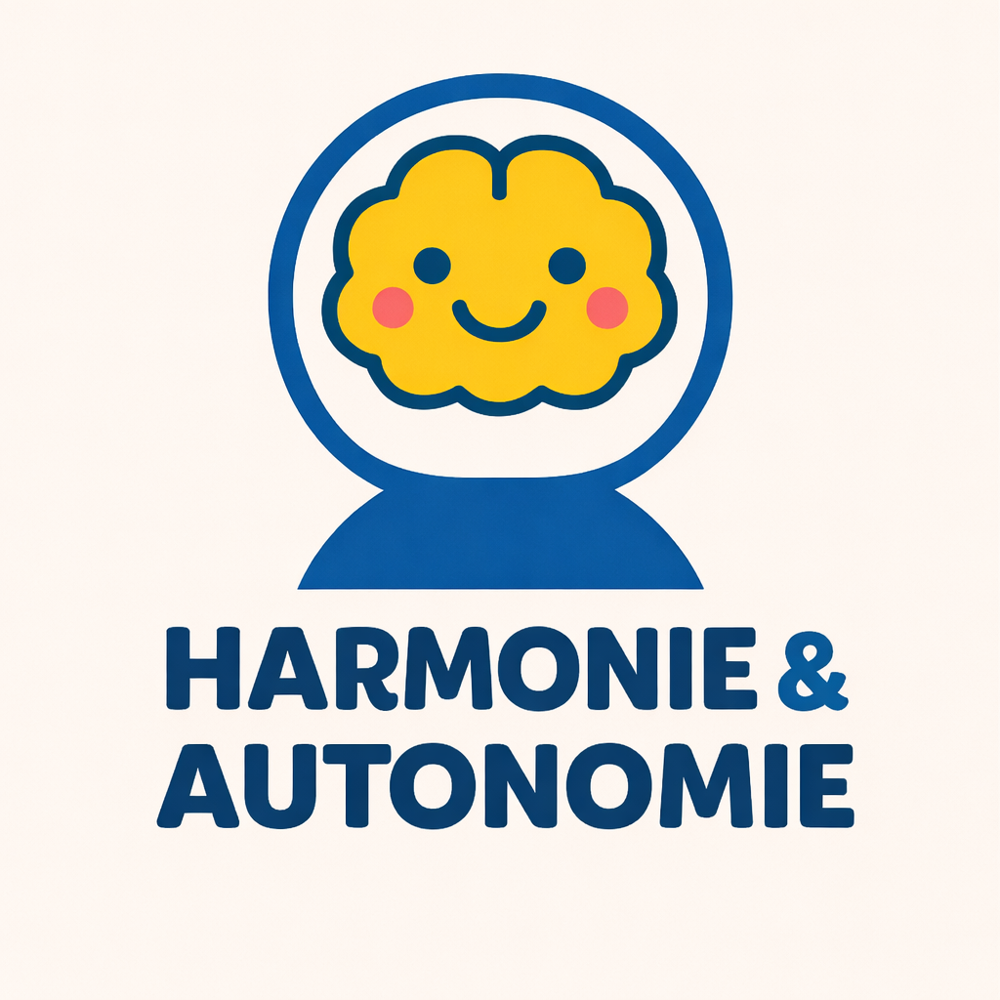

# Harmonie & Autonomie



Site web moderne et responsive pour une agence d'aide à domicile spécialisée dans l'accompagnement des personnes âgées et des enfants présentant des troubles du neurodéveloppement.

## 🎯 Aperçu

Harmonie & Autonomie est une plateforme web conçue pour présenter les services d'aide à domicile, permettre aux familles de découvrir l'équipe, et faciliter la prise de contact. Le site met en avant une approche bienveillante et professionnelle avec un design moderne et intuitif.

### 🏠 Pages principales

- **Accueil** : Présentation globale des services, statistiques, témoignages
- **À propos** : Histoire de l'entreprise, valeurs, équipe, engagements
- **Services** : Détail des prestations, processus d'accompagnement, FAQ
- **Contact** : Formulaire de contact, coordonnées, carte interactive
- **Politique de confidentialité** : Informations RGPD, mentions légales

## 🚀 Technologies utilisées

- **Framework** : [Next.js 15](https://nextjs.org/) (App Router)
- **Langage** : [TypeScript](https://www.typescriptlang.org/)
- **Styling** : [Tailwind CSS](https://tailwindcss.com/)
- **Animations** : [Framer Motion](https://www.framer.com/motion/)
- **Icônes** : [Lucide React](https://lucide.netlify.app/)
- **Déploiement** : [Vercel](https://vercel.com/)

## ✨ Fonctionnalités

- ✅ Design responsive (mobile, tablette, desktop)
- ✅ Animations fluides au scroll
- ✅ Navigation intuitive avec header sticky
- ✅ Menu mobile optimisé
- ✅ Formulaire de contact avec validation
- ✅ Carte interactive Google Maps
- ✅ Timeline interactive pour l'histoire de l'entreprise
- ✅ FAQ avec accordéon
- ✅ Optimisation SEO de base
- ✅ Accessibilité améliorée

## 🎨 Palette de couleurs

- **Bleu principal** : `#0959a1` - Confiance, professionnalisme, sérénité
- **Jaune accent** : `#fdc81e` - Chaleur, bienveillance, énergie positive
- **Blanc/Gris** : Fonds neutres pour une lecture confortable

## 📦 Installation

1. **Cloner le repository**

   ```bash
   git clone https://github.com/willdevelp/harmonie
   cd harmonie
   ```

2. **Installer les dépendances**

   ```bash
   npm install
   # ou
   yarn install
   # ou
   pnpm install
   ```

3. **Lancer le serveur de développement**

   ```bash
   npm run dev
   # ou
   yarn dev
   # ou
   pnpm dev
   ```

4. **Ouvrir le navigateur**
   ```
   http://localhost:3000
   ```

## 🏗️ Structure du projet

```
harmonie/
├── app/
│   ├── a-propos/          # Page À propos
│   ├── contact/            # Page Contact
│   ├── politique-de-confidentialite/ # Page RGPD
│   ├── services/           # Page Services
│   ├── layout.tsx          # Layout principal
│   └── page.tsx            # Page d'accueil
├── components/
│   ├── header.tsx          # Navigation principale
│   └── footer.tsx          # Pied de page
├── public/                 # Images et assets
│   ├── logo.png
│   ├── hand.jpeg
│   ├── ladies.jpeg
│   └── ...
└── ...
```

## 🚀 Déploiement

Le site est optimisé pour un déploiement sur [Vercel](https://vercel.com/) :

```bash
npm run build
# ou
vercel --prod
```

## 👥 Contributeurs

Ce projet a été réalisé par une équipe de deux développeurs passionnés :

### [William](https://github.com/willdevelp/)

- Architecture du projet
- Développement des composants principaux
- Design system et charte graphique

### [Kilua Zoldick](https://github.com/kiluazoldick)

- Structure des pages
- Implémentation du responsive
- Intégration des animations
- Optimisation des performances

## 📝 License

Ce projet est la propriété d'Harmonie & Autonomie. Tous droits réservés.

## 📞 Contact

Pour toute question concernant ce projet :

- **Email** : contact@harmonie-autonomie.fr
- **Téléphone** : 07 43 58 72 81

---

Développé avec ❤️ pour améliorer le quotidien des familles
